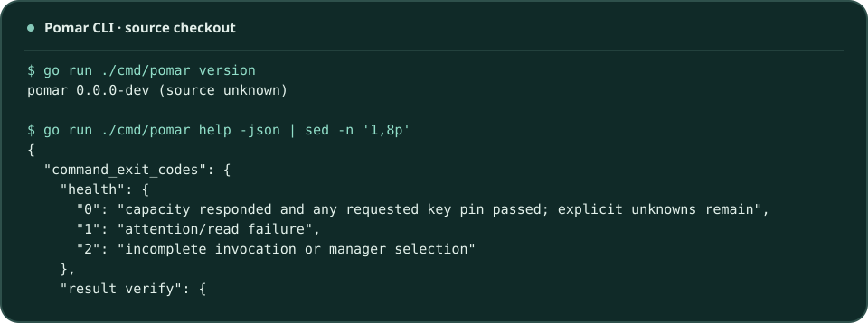
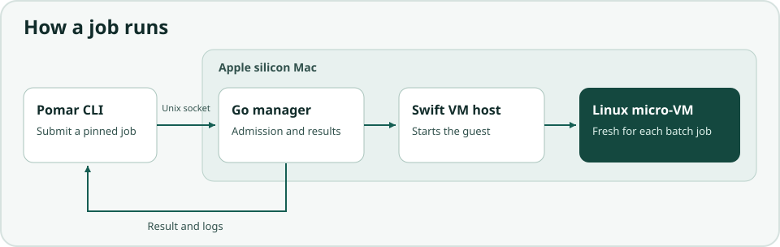
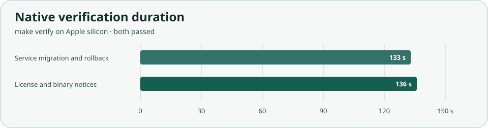

# Pomar

**Run pinned Linux jobs in fresh micro-VMs on Apple silicon and verify the results.**





## 60-second quick start

With Go 1.27.x already installed on an Apple silicon Mac, clone the repository
and explore the CLI. The first build may take longer.

```sh
git clone https://github.com/rodriveracom/pomar.git
cd pomar
go run ./cmd/pomar version
go run ./cmd/pomar help -json | sed -n '1,8p'
```

The last command previews the machine-readable command catalog. To run a VM,
[build and install the bundle](docs/install.md#build-and-install-from-source)
and follow the [development manager quick start](docs/operations.md#development-manager).

## What makes Pomar different

- **A fresh VM for each batch job.** Guests use pinned inputs, controlled
  egress, and no host credentials. See [manager classes](docs/manager-classes.md).
- **Verifiable results.** With a signing-enabled manager, verify results and
  logs against the owner's independently supplied public key. See the
  [signed job workflow](docs/operations.md#submit-inspect-and-verify-a-job).
- **Retained environments for interactive work.** Keep development state when
  you reconnect. See [agent environments](docs/agent-environments.md).

## Verification and release status



[Commands, exact commits, and receipt digests](docs/verification.md) document
these build and test runs. VM startup latency, throughput, and capacity for
concurrent development environments are unmeasured.

There is [no published binary release](https://github.com/rodriveracom/pomar/releases).
Build from source or use an approved manager. See the
[project status and work in review](docs/verification.md#project-status).

## Guides

- [Install, upgrade, and roll back](docs/install.md)
- [Run and verify jobs](docs/operations.md)
- [CLI use from scripts and agents](AGENTS.md)
- [Health and diagnostics](docs/health-and-diagnostics.md)
- [Switch harnesses in retained environments](docs/harness-switching.md)
- [Contribute](CONTRIBUTING.md) and [prepare releases](docs/releases.md)

Pomar is licensed under the [MIT License](LICENSE).
